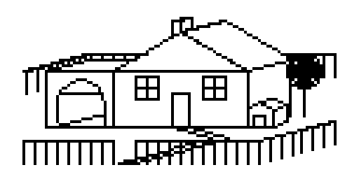
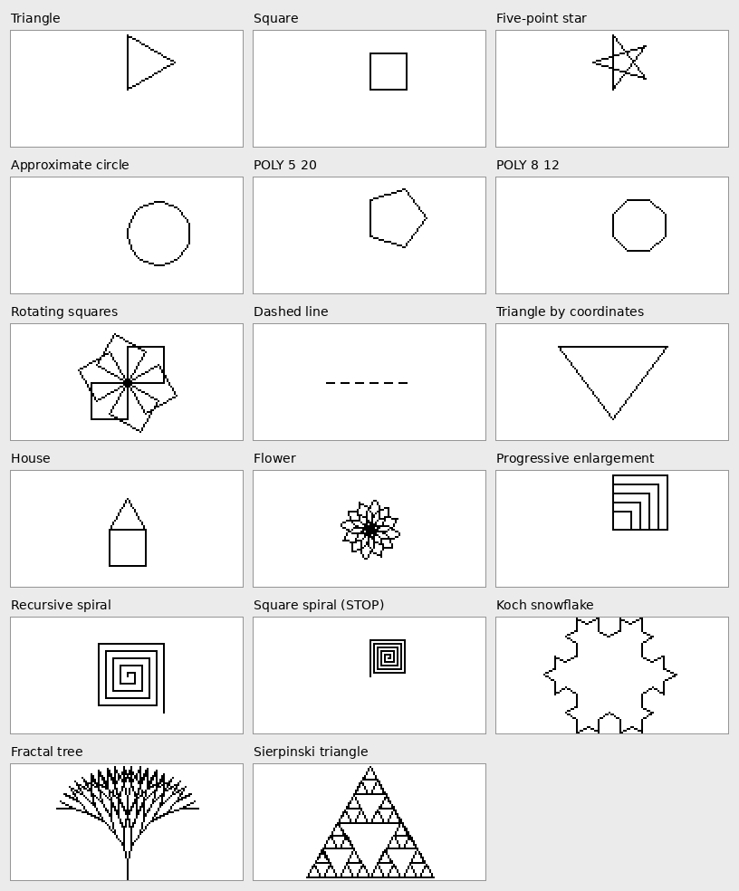

# TEC Logo — User Guide

A compact Logo implementation for the TEC-1G. Logo commands are entered via a serial terminal; the turtle draws on the 128×64 graphics LCD (GLCD).

Programmed by B. Chiha for the TEC-1G


---

## 1. Requirements

| Item | Notes |
| ---- | ----- |
| TEC-1G with MON3 | Program loads at **0x4000** and starts at **0x4000** |
| GLCD (ST7920, 128×64) add-on Board | Drawing surface |
| FTDI USB serial adaptor | Connected to the TEC-1G serial |
| Serial terminal program | On the host computer (TeraTerm, PuTTY, minicom, screen…) |

### Terminal settings

| Setting | Value |
|---------|-------|
| Speed | **4800 baud** |
| Data bits | **8** |
| Parity | **None** |
| Stop bits | **2** |
| Flow control | None |
| Local echo | **Off** (TEC provides its own echo) |
| Enter key sends | **CR** (CR+LF also accepted) |

### Startup

1. Load the program into RAM at 0x4000.
2. Begin execution at 0x4000 (TEC keypad: **AD**, enter `4000`, then **GO**).
3. The terminal displays:

```
TEC-1G Logo by B. Chiha (2026)   BYE exits, NEW starts again
? 
```

The `?` is the command prompt. Enter a command and press Enter. The GLCD switches to graphics mode and displays the turtle drawing.


---

## 2. Brief introduction to Logo

Logo originated in the 1960s as an educational programming language. Its best-known feature is turtle graphics.

A virtual turtle occupies the centre of the screen and holds a pen. Simple instructions move and turn the turtle:

- advance **forward** a given number of steps,
- turn **right** a given number of degrees,
- raise the pen (movement without drawing).

Complex figures are constructed by combining elementary moves, repetition, and user-defined procedures that behave as new commands.


```
? REPEAT 4 [ FD 20 RT 90 ]
```

produces a square.

### Screen and turtle

- Display resolution is **128 pixels wide by 64** pixels high.
- The turtle begins at the centre — the home position, coordinate **(0, 0)**.
- Positive x points right; positive y points up.
  Visible range is approximately x = **−64 … 63**, y = **−31 … 32**.
- Heading is expressed in whole degrees. **0° points straight up**, 90° right, 180° down, 270° left. `RT` rotates clockwise.
- The pen starts down; movement therefore draws. `PU` raises the pen.
- Lines that leave the visible area are clipped. The turtle may leave and re-enter the screen; only the visible portion is rendered.

### Numeric representation

All values are **16-bit signed integers** (−32768 … 32767). No fractional arithmetic is provided: `7 / 2` evaluates to `3`, and `−7 / 2` evaluates to `−3`. Overflow wraps around (32767 + 1 yields −32768).

---

## 3. Command prompt operation

### Keyboard handling

| Key | What it does |
|-----|--------------|
| Enter | Terminates the current line; the complete entry is executed |
| Backspace / Delete | Deletes the last character of the current line |
| **Esc** or **Ctrl-C** | Discards the entire entry (including any preceding continuation lines) |
| Tab | Inserts a space |

Input is case-insensitive: `fd 10`, `Fd 10` and `FD 10` are equivalent.

### Multi-line entries and the `>` prompt

An unmatched `[` or an open `TO` changes the prompt to `>` and waits for further input:

```
? REPEAT 4 [
>   FD 20
>   RT 90
> ]
```

Execution begins once brackets are balanced (and, for a procedure definition, once `END` is received).

A single entry may contain approximately **500 characters**. Procedures should be kept compact; large programs are best split across several procedures.

> **IF … [ … ] [ … ] (else):** the opening `[` of the else-block must appear on the **same line** as the `]` that closes the then-block (see section 5).

### Program-control commands

These words are recognised only when they appear as the first token of an entry:

| Command | What it does |
|---------|--------------|
| `LIST` | Displays the source of all defined procedures |
| `LIST name` | Displays a single procedure |
| `ERASE name` | Removes one procedure |
| `NEW` | Clears all procedures and variables, clears the screen, returns the turtle home |
| `TRACE` | Toggles the disassembler trace (see 3.2) |
| `BYE` | Exits Logo and returns control to the TEC-1G monitor |
`LIST`, `ERASE`, `NEW`, `TRACE`, `BYE` and `STOP` are reserved; they may not be used as procedure names.

#### ERASE

```
? ERASE SQUARE
```

If another procedure still references the target, the operation is refused with the message *"Call to a procedure not defined yet"*. The dependent procedure must be erased or rewritten first.

### Stopping execution (BREAK)

Any key on the TEC-1G keypad (except RESET/FN) pressed while a program is running aborts execution and returns to the prompt:

```
Stopped: key pressed
?
```

Variables, procedures and the current drawing remain intact. The break check occurs on every `REPEAT` iteration and every procedure call.

### 3.2 TRACE: virtual-machine instruction dump

Issuing `TRACE` enables the disassembler. Each virtual-machine instruction is printed with its address immediately before execution:

```
? TRACE
disassembler ON
? REPEAT 2 [ FD 5 ]
3400: PUSH_CONST 2
3403: LOOP_START 0x340D
3406: PUSH_CONST 5
3409: FD
340A: LOOP_END   0x3406
3406: PUSH_CONST 5
3409: FD
340A: LOOP_END   0x3406
340D: HALT
? TRACE
disassembler OFF
?
```

The output is relatively slow because it travels over the serial link, but it shows the compiled form of the Logo source exactly. A second `TRACE` disables the dump.

### Error handling

On error a diagnostic message is printed and control returns to the prompt. Previously defined procedures and variables are retained. The failed entry is discarded (a procedure that compiled successfully before a later command on the same line failed is retained).

Example:

```
? FD 10 / 0
VM Error: Divide by Zero
? 
```

A complete list of messages appears in section 8.

### Host-to-TEC program transfer

Logo source may be prepared on a host computer and transferred via the serial link. Because the TEC processes the stream byte-by-byte and compiles each entry, a line-delay of 80–200 ms (and, if required, a small inter-character delay) should be configured in the terminal emulator.

Each entry (a single command or a complete `TO … END`) must remain within the approximate 500-character limit; the body of a large `REPEAT` is subject to the same constraint.

Single-command lines (e.g. `FD 10`) transfer most reliably. Complex `REPEAT` constructs are best unrolled before transmission.

---

## 4. Language reference

In the examples that follow, `?` denotes the prompt; the remainder is entered by the operator.

### Movement

#### `FD distance`: forward

Advances the turtle in its current heading, drawing when the pen is down.

```
? FD 20
```

#### `BK distance`: back

Moves the turtle opposite to its heading (heading itself is unchanged).

```
? BK 10
```

#### `RT angle` / `LT angle`: turn right/left

Rotates the turtle in place by the given number of degrees. Negative values reverse the sense of rotation; angles outside 0–359 wrap modulo 360.

```
? RT 90
? LT 45
```

A square assembled from successive commands:

```
? FD 20
? RT 90
? FD 20
? RT 90
```

### Pen control

#### `PU` / `PD`: pen up / pen down

With the pen raised the turtle relocates without drawing. The pen is initially down.

```
? PU
? FD 10
? PD
? FD 10
```

### Positioning

#### `HOME`

Returns the turtle to the origin pointing upward. A line is drawn if the pen is down.

```
? HOME
```

#### `SETXY x y`

Moves the turtle to absolute coordinates (x, y), drawing when the pen is down. Heading is unchanged.

```
? PU
? SETXY -30 20
? PD
? SETXY 30 20
```

> **Negative second operand:** `SETXY 0 -20` is parsed as the subtraction `0 - 20` and then fails for a missing second argument. Enclose a negative second operand in parentheses: `SETXY 0 (-20)`. A negative first operand requires no special treatment: `SETXY -30 20`.

#### `SETX x`, `SETY y`

Alter a single coordinate.

```
? SETX 25
? SETY (-10)
```

(`SETY -10` is also accepted. Parentheses are required only when a numeric literal immediately follows another numeric token.)

#### `CS`: clear screen

Erases the drawing and returns the turtle to home, heading 0°. Variables and procedures are unaffected.

```
? CS
```

### Iteration

#### `REPEAT count [ commands ]`

Executes the enclosed commands `count` times. `count` may be any expression. A non-positive count produces no iterations.

```
? REPEAT 4 [ FD 20 RT 90 ]
? REPEAT 36 [ FD 3 RT 10 ]
```

Nested `REPEAT` is permitted:

```
? REPEAT 6 [ REPEAT 4 [ FD 15 RT 90 ] RT 60 ]
```

### Variables and expressions

#### `MAKE "name value`: create or assign a variable

```
? MAKE "SIDE 20
? REPEAT 4 [ FD :SIDE RT 90 ]
```

- `"SIDE` (leading double-quote) designates the variable being assigned.
- `:SIDE` (leading colon) retrieves the current value.
- The right-hand side may be any expression: `MAKE "SIDE :SIDE + 5`.
- Variable names consist of letters only, maximum length **8**, and are case-insensitive. An unbound variable yields 0.
- A maximum of 16 distinct variables is available (procedure parameters share the same pool).

Variables persist across entries:

```
? MAKE "N 3
? MAKE "N :N + 1
? REPEAT :N [ FD 5 ]
```

#### Expressions

Any numeric context accepts an expression composed of:

| Operator | Meaning |
|----------|---------|
| `+` `-` `*` `/` | Addition, subtraction, multiplication, integer division |
| `( )` | Grouping |
| `-x` | Unary negation |
| `:name` | Variable reference |

Multiplication and division bind more tightly than addition and subtraction; parentheses override the default precedence. Division by zero raises a run-time error.

```
? FD 5 * 4 + 2
? RT 360 / 5
? FD (:SIDE + 2) * 3
```

### Conditional execution

#### `IF a <test> b [ commands ]`

Executes the enclosed commands only when the relational test is true. Supported operators:

| Test | Meaning |
|------|---------|
| `=` | equal |
| `<>` | not equal |
| `<` | less than |
| `>` | greater than |
| `<=` | less than or equal |
| `>=` | greater than or equal |

```
? MAKE "A 3
? IF :A > 2 [ FD 10 ]
```

#### `IF a <test> b [ then ] [ else ]`

A second bracketed block is executed when the test is false. The opening `[` of the else-block must appear on the same line as the closing `]` of the then-block:

```
? IF :A < 2 [ BK 10 ] [ FD 20 ]
```

Over several lines:

```
? IF :N = 0 [ FD :L ] [
>   LT 60
>   FD 5
> ]
```

### User-defined procedures

#### `TO name :param … … END`

Defines a new command. Up to four parameters may be declared, each written `:name`.

```
? TO SQUARE :SIDE
>   REPEAT 4 [ FD :SIDE RT 90 ]
> END
? SQUARE 10
? SQUARE 30
```

- Procedure names consist of letters only, maximum length **8**, and must not collide with built-in commands.
- A maximum of **8** procedures may be defined.
- A procedure must be defined before any other procedure or top-level command that references it. Self-recursion is permitted.
- Nested `TO` is illegal.
- Arguments follow the procedure name: `POLY 5 20`. Each argument may itself be an expression: `SQUARE :S + 5`.
- Parameters occupy variable slots; a parameter temporarily shadows any global of the same name and the previous value is restored on exit.
- Variables created with `MAKE` inside a procedure are global and retain their values after the procedure returns.

Definition and invocation may occupy a single line:

```
? TO DASH REPEAT 6 [ PD FD 4 PU FD 4 ] END DASH
```

**Redefinition**: re-entering a procedure with the same name replaces the previous body. Callers of the procedure automatically receive the new definition. If the new body fails to compile, the previous definition is retained.

**Inspection:**

```
? LIST
TO SQUARE :SIDE
  REPEAT 4 [ FD :SIDE RT 90 ]
END
```

#### `STOP`

Terminates the innermost procedure immediately (even from inside a `REPEAT` or `IF`) and returns to the caller. It is the normal means of terminating recursion.

```
? TO COUNT :N
>   IF :N = 0 [ STOP ]
>   FD :N
>   RT 90
>   COUNT :N - 1
> END
? COUNT 12
```

`STOP` entered at the top-level prompt simply ends the current entry.

---

## 5. Worked Examples

Each example has been verified to remain inside the 128×64 visible area. Many drawings begin at the origin and extend upward; issue `CS` between successive figures to clear the display.



### Elementary polygons with REPEAT

```
? REPEAT 3 [ FD 30 RT 120 ]   ; triangle
? REPEAT 4 [ FD 20 RT 90 ]    ; square
? REPEAT 5 [ FD 30 RT 144 ]   ; five-point star
? REPEAT 36 [ FD 3 RT 10 ]    ; approximate circle
```

### Parameterised polygon

The exterior angle is 360 divided by the number of sides.

```
? TO POLY :SIDES :LEN
>   REPEAT :SIDES [ FD :LEN RT 360 / :SIDES ]
> END
? POLY 5 20
? POLY 8 12
```

### Rotating squares

```
? TO SQ :S
>   REPEAT 4 [ FD :S RT 90 ]
> END
? REPEAT 6 [ SQ 20 RT 60 ]
```

### Dashed line

```
? TO DASH
>   REPEAT 6 [ PD FD 4 PU FD 4 ]
> END
? PU
? SETXY -24 0
? PD
? RT 90
? DASH
```

### Triangle by absolute coordinates

```
? PU
? SETXY -30 20
? PD
? SETXY 30 20
? SETXY 0 (-20)
? SETXY -30 20
```

### House

```
? TO HOUSE
>   REPEAT 4 [ FD 20 RT 90 ]
>   FD 20
>   RT 30
>   REPEAT 3 [ FD 20 RT 120 ]
>   LT 30
>   BK 20
> END
? PU
? SETXY -10 (-20)
? PD
? HOUSE
```

### Flower composed of petals

```
? TO PETAL
>   REPEAT 2 [ REPEAT 9 [ FD 2 RT 10 ] RT 90 ]
> END
? TO FLOWER
>   REPEAT 12 [ PETAL RT 30 ]
> END
? FLOWER
```

### Progressive enlargement via a variable

```
? MAKE "SIDE 10
? REPEAT 5 [ REPEAT 4 [ FD :SIDE RT 90 ] MAKE "SIDE :SIDE + 5 ]
```

### Recursive spiral controlled by IF

```
? TO SPIRAL :S
>   IF :S < 40 [
>     FD :S
>     RT 90
>     SPIRAL :S + 2
>   ]
> END
? SPIRAL 2
```

### Self-terminating square spiral (STOP)

```
? TO COUNT :N
>   IF :N = 0 [ STOP ]
>   FD :N
>   RT 90
>   COUNT :N - 1
> END
? COUNT 20
```

### A snowflake (Koch curve)

A recursive edge replacement: each side is replaced by four sides of one-third the length with a central protrusion. `:N` is the recursion depth; `:L` is the base side length. Depth 3 with a 7-pixel side remains inside the display.

```
? TO KOCH :N :L
>   IF :N = 1 [ FD :L ] [
>     KOCH :N - 1 :L
>     LT 60
>     KOCH :N - 1 :L
>     RT 120
>     KOCH :N - 1 :L
>     LT 60
>     KOCH :N - 1 :L
>   ]
> END
? TO SNOW :N :L
>   REPEAT 3 [ KOCH :N :L RT 120 ]
> END
? PU
? SETXY -20 (-31)
? PD
? SNOW 3 7
```

Depth may be varied from 1 to 4 with correspondingly adjusted lengths. `SNOW 4 2` produces a dense figure; `SNOW 2 20` yields a coarser star-like outline. Any TEC keypad key aborts a lengthy rendering.

### Fractal Tree

```
? TO TREE :DEPTH :LENGTH :ANGLE
>   IF :DEPTH = 0 [ STOP ]
>   FD :LENGTH
>   RT :ANGLE
>   TREE :DEPTH - 1 :LENGTH :ANGLE
>   LT 2 * :ANGLE
>   TREE :DEPTH - 1 :LENGTH :ANGLE
>   RT :ANGLE
>   BK :LENGTH
> END
? PU
? SETY -31
? PD
? TREE 7 9 15
```

Varying the three parameters produces different branching styles.

### Sierpinski triangle

```
? TO SPINSKI :DEPTH :LENGTH
>   IF :DEPTH = 0 [ STOP ]
>   REPEAT 3 [
>      SPINSKI :DEPTH - 1 :LENGTH / 2
>      FD :LENGTH
>      RT 120
>   ]
> END
? PU
? SETXY -35 (-30)
? PD
? RT 30
? SPINSKI 4 70
```

Depths in the range 1–5 control the number of internal triangles.

---

## 6. Quick reference

| Command | Effect |
|---------|--------|
| `FD n` / `BK n` | Forward / back n steps |
| `RT n` / `LT n` | Turn right / left n degrees |
| `PU` / `PD` | Pen up / pen down |
| `HOME` | Return to origin, heading 0° |
| `SETXY x y` | Move to absolute (x, y) |
| `SETX x` / `SETY y` | Alter a single coordinate |
| `CS` | Clear the screen and return home |
| `REPEAT n [ … ]` | Iterate the enclosed commands n times |
| `MAKE "v expr` | Assign expression to variable v |
| `:v` | Value of variable v |
| `IF a < b [ … ]` | Conditional execution (then only) |
| `IF a < b [ … ] [ … ]` | Conditional execution with else branch |
| `TO name :p … END` | Define a procedure |
| `STOP` | Exit current procedure |
| `LIST [name]` | Display procedure text |
| `ERASE name` | Delete a procedure |
| `NEW` | Reset all state |
| `TRACE` | Toggle instruction trace |
| `BYE` | Return to the TEC-1G Monitor |
| Any TEC key | Abort running program |
| Esc / Ctrl-C | Cancel incomplete entry |

### Resource Limits

| Resource | Limit |
|----------|-------|
| Variables | 16 |
| Procedures | 8 |
| Parameters per procedure | 4 |
| Name length | 8 letters (letters only) |
| Single entry | about 500 characters |
| Numeric range | -32768 … 32767, (integers) |
| Nested `TO` | prohibited |

---

## 7. Implementation notes and common pitfalls

- A numeric literal immediately followed by a minus sign is parsed as subtraction. Parentheses are required for a negative operand in that position: `SETXY 10 (-5)`, `POLY 5 (-20)`.
- Names may contain only letters; digits are illegal (`SQ2` is rejected).
- Procedures must be defined before any reference to them.
- Redefinition replaces the previous body in place; existing callers automatically use the new definition.
- The opening `[` of an else-block must share the line with the preceding `]`.
- Drawings that leave the 128×64 window are clipped; if a figure appears missing, issue `CS` or verify coordinate values.
- The display is refreshed after every drawn segment. A TEC keypad key aborts a lengthy rendering.
- Large programs are best prepared on a host system and transferred with a per-line delay of 100–200 ms. Keep each procedure under the 500-character limit.
- `LIST` enumerates currently defined procedures; `NEW` restores a clean state.

---

## 8. Diagnostic messages

| Message | Cause |
|---------|-------|
| Lexical Error: Invalid character | Unrecognised character (e.g. `@`) |
| Lexical Error: Quoted word expected | `"` not followed by a name |
| Lexical Error: Variable reference expected | `:` not followed by a name |
| Lexical Error: String too long | Name exceeds 8 letters |
| Lexical Error: Number too large for 16 bits | Literal larger than 65535 |
| Parse Error: Unknown command | Token that is neither a command nor a defined procedure |
| Parse Error: Call to a procedure not defined yet | Reference to an undefined, erased or mistyped procedure name |
| Parse Error: Expected number, variable, '(', or '-' | Missing numeric value (e.g. `FD` alone, or `SETXY 0 -20` without parentheses) |
| Parse Error: Expected [ | `REPEAT` or `IF` missing its opening bracket |
| Parse Error: Expected ] | Unmatched closing bracket |
| Parse Error: Expected ) | Unmatched closing parentheses |
| Parse Error: Expected end of input | Extraneous tokens after a complete statement |
| Parse Error: Expected END | `TO` not terminated by `END` |
| Parse Error: Expected comparison operator | `IF` missing a relational operator |
| Parse Error: MAKE not followed by quoted word | Incorrect `MAKE` syntax |
| Parse Error: TO not followed by a name | `TO` missing procedure name |
| Parse Error: Nested TO statements not allowed | `TO` appearing inside another `TO` |
| Parse Error: Too Many Variable references (MAX 16) | More than 16 distinct variable names |
| Parse Error: Too Many Parameters (MAX 4) | Procedure declared with more than four parameters |
| Parse Error: Too Many Procedures (MAX 8) | Attempt to define a ninth procedure |
| Definitions Error: No such procedure | `LIST` or `ERASE` naming an undefined procedure |
| Definitions Error: No room to store the procedure | Procedure text storage exhausted |
| Code Gen Error: Byte Code area full | Compiled code exceeds available space |
| VM Error: Divide by Zero | Division by zero at run time |
| VM Error: Return Stack overflow | Excessive recursion depth |
| VM Error: Loop Stack overflow | Excessive nested `REPEAT` constructs |
| VM Error: Value Stack overflow | Expression evaluation stack exhausted |
| VM Error: Save Stack overflow | Too many parameters saved across nested calls |
| Stopped: key pressed | Operator aborted execution via TEC keypad |

After any diagnostic the system returns to the `?` prompt and is ready for further input.
